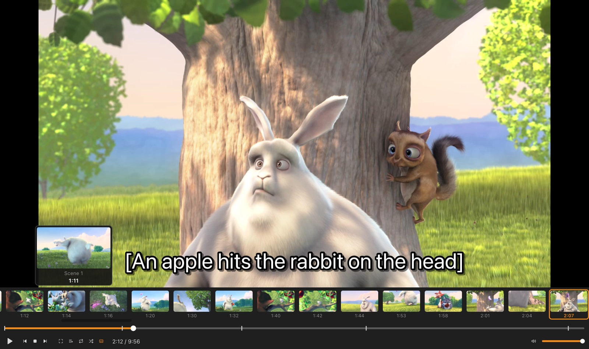
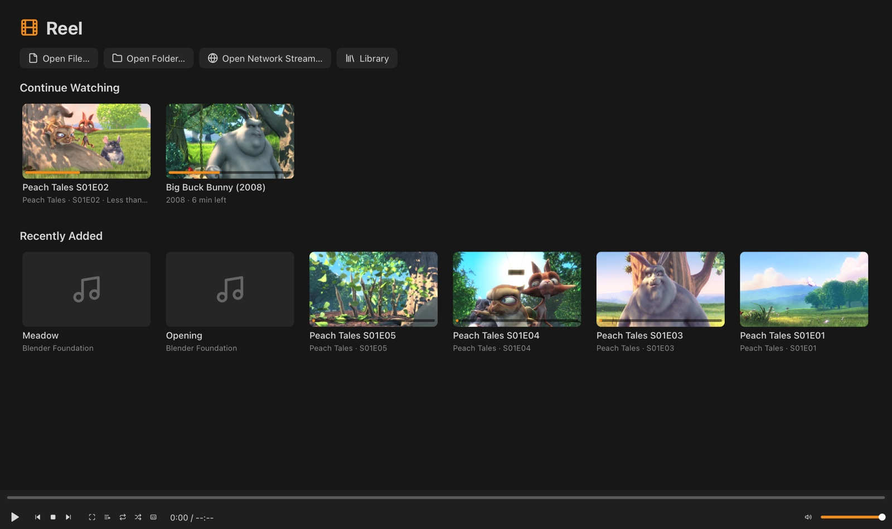
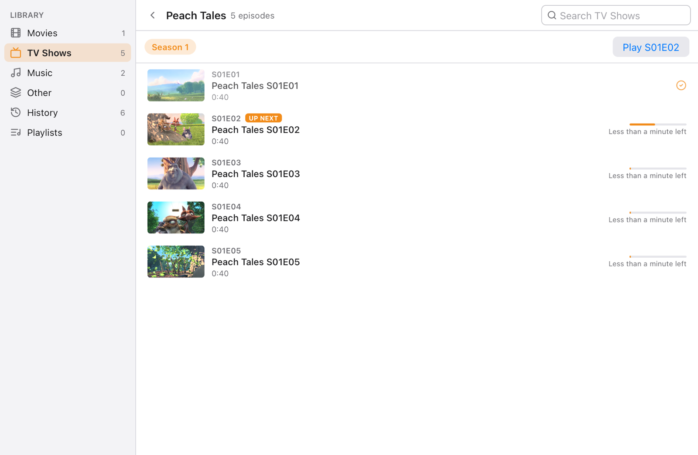
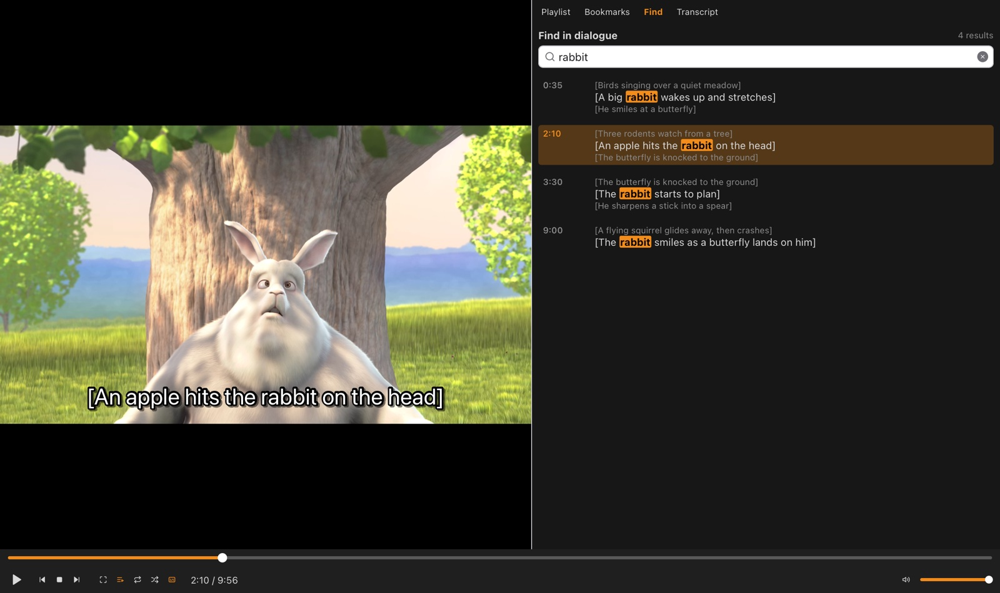
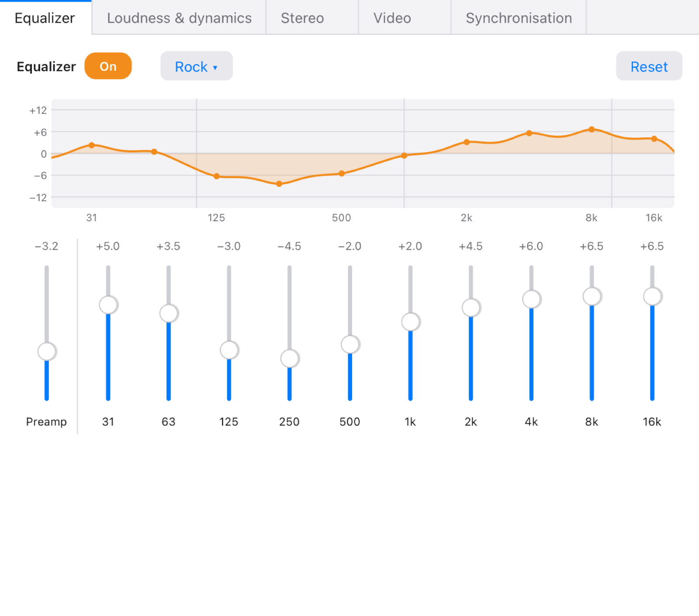
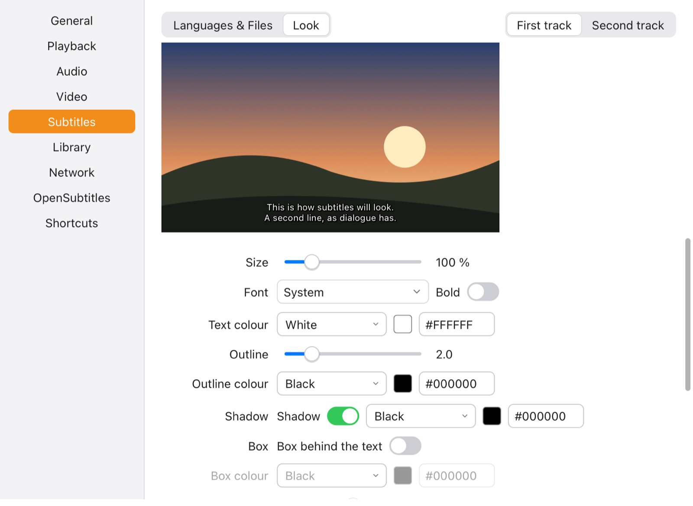
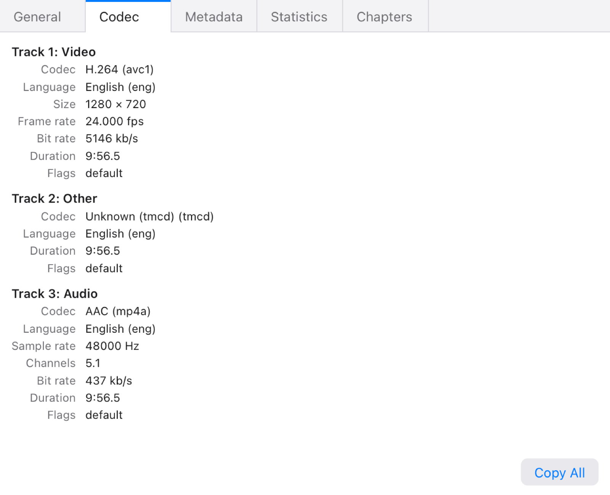
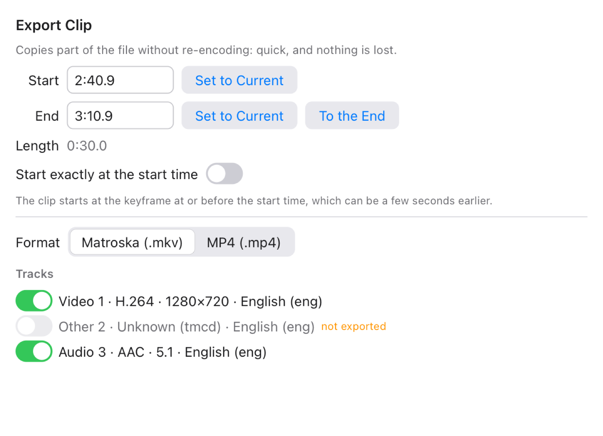

# Reel

A media player written entirely in [Tessel](https://tessel-lang.syncster.dev):
every container, every video and audio decoder, the effects, the library and
the interface, with no FFmpeg and no native media libraries. It plays the
files VLC plays, and adds a few things VLC doesn't.



## Features

**Playback**
- Plays local files, folders, playlists, network streams (HLS, DASH, plain
  http/https) and DVD and Blu-ray folders or `.iso` images.
- Frame-exact stepping forwards **and backwards**, A-B loop, bookmarks,
  chapters, jump to time, speed 0.25–4× with pitch kept, sleep timer.
- Thumbnail previews when hovering over the seek bar, and a **scene strip**
  that also makes chapters for files without any.
- Remembers each file's position, tracks, volume, speed, delays, picture
  settings and equalizer; a home screen with "Continue watching" and the next
  episode, which plays on its own at the end of the current one.

**Picture and sound**
- Effects and Filters: 10-band equalizer with presets, loudness
  normalisation (EBU R128, ReplayGain), compressor and limiter, stereo modes,
  headphone crossfeed; brightness, contrast, saturation, hue and gamma;
  crop with black-bar detection, aspect ratio, zoom, flip and rotate;
  sharpen and denoise.
- Automatic deinterlacing of interlaced TV, DVD and VC-1 video (a
  motion-adaptive deinterlacer, single or double rate).
- Audio/video and subtitle synchronisation.

**Subtitles**
- SRT, ASS/SSA, WebVTT, MP4 timed text, Blu-ray PGS and DVD subtitles, in the
  file or beside it (name variants, language codes, `Subs/` folders).
- A second subtitle track at the top, style settings with a live preview,
  text-encoding detection (including Chinese, Japanese and Korean).
- **Find in dialogue** across every subtitle track, and a transcript that
  follows playback.
- OpenSubtitles search and download (with your own API key).

**Library and export**
- A library of your folders: Movies, TV shows by series and season with
  watched marks, Music by artist and album, history, playlists (M3U, PLS,
  XSPF, WPL, CUE).
- **Lossless clip export** of a range to MKV or MP4 without re-encoding, and
  GIF export.
- Customisable shortcuts, a mini player, a statistics overlay and a media
  information window.

## Screenshots

| | |
|---|---|
|  |  |
| Home screen: continue where you left off. | Library: a TV season with watched marks and progress. |
|  |  |
| Find in dialogue, beside the picture. | Effects and Filters: the equalizer. |
|  |  |
| Preferences: subtitle look, with a live preview. | Media information. |
|  | |
| Lossless clip export. | |

## Formats

Every decoder is checked frame by frame or sample by sample against
reference decoders and the official conformance streams.

| Video | Checked against |
|---|---|
| H.264 | 180 of 185 JVT conformance streams bit-exact |
| HEVC (H.265), 8/10-bit | all 146 JCT-VC Main/Main10 streams bit-exact |
| AV1, 8/10/12-bit, film grain | all 242 libaom test vectors bit-exact |
| VP9, 8/10/12-bit | all 314 libvpx test vectors bit-exact |
| VP8 | all 62 libvpx test vectors bit-exact |
| MPEG-1, MPEG-2, MPEG-4 Part 2 (DivX, Xvid) | bit-exact |
| DivX 3, WMV7/8/9, VC-1 (incl. interlaced) | bit-exact |
| Theora, ProRes, DNxHD/DNxHR, Motion JPEG | bit-exact |

| Audio | Checked against |
|---|---|
| AAC (LC, HE, HEv2), MP3, MP2, Vorbis, Opus, AC-3, E-AC-3 (to 7.1), WMA 1/2, WMA Pro | ffmpeg's output to rounding (≥ 90 dB) |
| DTS, DTS-HD Master Audio, TrueHD/MLP (Atmos bed), FLAC, ALAC, WMA Lossless, PCM | bit-exact |

**Containers:** MP4/MOV, MKV/WebM, AVI, Ogg, MPEG-TS/M2TS, MPEG-PS/VOB,
ASF (WMV/WMA), WAV/AIFF, IVF, and raw MP3, AAC, AC-3, DTS and TrueHD streams.

## Building and running

Reel needs Tessel 0.15.0 (`tessel.toml` pins it; the `tessel` command fetches
it). From this folder:

```sh
tessel run .                    # run Reel
tessel build . -o build/reel    # or build it (about 20 s)
```

Open files with Media ▸ Open File (⌘O), by dropping them on the window, or
from the command line: `build/reel movie.mkv`.

## Tests

Each module has a test in `tests/<module>/main.tsl`; there are 42 suites and
about 8,250 checks. The shared fixtures are made with ffmpeg (used only as a
reference, never by Reel itself):

```sh
tools/make_fixtures.sh          # once: makes tests/fixtures (needs ffmpeg 8.1)
tests/run.sh                    # every suite
tests/run.sh hevc av1           # some of them
```

Some suites also use downloaded conformance streams in `build/conformance/`;
each module's test or `fetch.sh` script says where they come from, and the
checks that need them are skipped when they're missing.

## How it works

- **Demuxing.** `demux/` reads the whole container into a list of packets
  (`core.Media`) with byte positions, times and keyframes.
- **Video.** Heavy decoders (H.264, HEVC, VP9, AV1) are split into a parser
  and a reconstructor that run in two Tessel background jobs at once (H.264
  also splits luma and chroma), so a 1080p picture takes 12–25 ms. Pictures
  go through the converter (`render/` and `vfx/`: deinterlacing, filters,
  picture settings, scaling to the window) in another job, and the player
  draws the frame that's due on a canvas.
- **Sound.** Decoded sound is mixed to 48 kHz stereo, runs through the
  effects chain (`fx/`) and is played as WAV chunks with short crossfades;
  the next chunk is loaded ahead so it starts at once. The clock follows the
  sound.
- **Streams.** `net/` parses HLS and DASH, chooses the quality, decrypts
  AES-128 segments and joins the segments into a growing buffer that the
  player treats like a file.

| Folder | What's in it |
|---|---|
| `core/` | Media, tracks, packets, pictures, samples, bit readers |
| `demux/` | MP4, MKV, AVI, Ogg, TS, PS, ASF, WAV, IVF, raw streams |
| `h264/` `hevc/` `av1/` `vp9/` `vp8/` `mpeg12/` `mpeg4/` `wmv/` `theora/` `prores/` `dnxhd/` `jpeg/` | Video decoders |
| `aac/` `mpa/` `vorbis/` `opus/` `ac3/` `dts/` `truehd/` `wma/` `lossless/` | Audio decoders |
| `subs/` | Subtitle formats, styling, encodings, OpenSubtitles, dialogue search |
| `render/` `vfx/` `fx/` | Colour conversion and scaling; video filters; audio effects |
| `play/` | The pumps that drive the decoders, thumbnails and scene scans |
| `library/` `net/` `export/` `disc/` `xml/` | Library and playlists; streaming; MKV/MP4/GIF writers; DVD and Blu-ray; XML |
| `ui/` | The interface's panels and windows |
| `main.tsl`, `player.tsl`, `info.tsl` | The app |
| `build/*.md` | The design notes and briefs the modules were built from |

## Limits

- Tessel can only read whole files (Tessel issue #45), so files are loaded
  into memory: Blu-ray stream files (20–60 GB) and files larger than your RAM
  can't play yet.
- 4K plays correctly but not yet smoothly.
- Audio effect changes are heard after about two seconds (sound is decoded
  ahead).
- Not possible in Tessel today: Chromecast, a web remote, RTSP/UDP streams,
  hardware decoding. Encrypted commercial discs aren't supported.

## Licence

Reel is not released yet. Several decoders (TrueHD, DTS, VC-1/WMV, WMA,
Theora, VP9, and parts of AAC, AC-3, MP3, ALAC, MPEG-4, ProRes and DNxHD)
follow FFmpeg's source code, which is licensed under the LGPL 2.1 or later;
that has to be settled before Reel is distributed.

## Credits

- Written by Alexius Academia — [syncster.dev](https://syncster.dev).
- Screenshots show *Big Buck Bunny* © Blender Foundation,
  [peach.blender.org](https://peach.blender.org), licensed under
  [CC BY 3.0](https://creativecommons.org/licenses/by/3.0/); the captions are
  ours.
- Icons from [Lucide](https://lucide.dev) (ISC licence).
